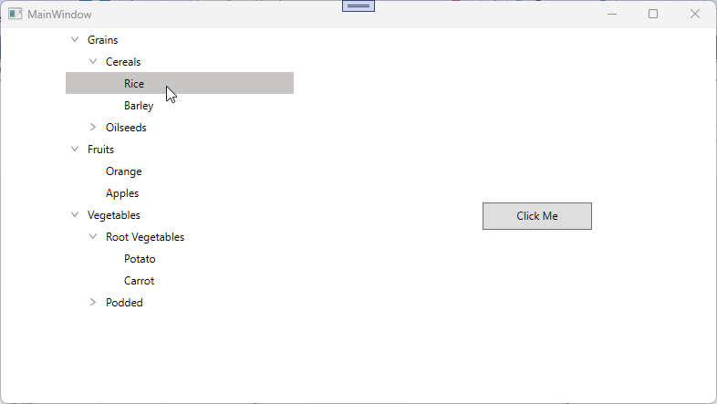

# How-to-change-the-selection-color-of-the-selected-item-based-on-focus-in-a-WPF-SfTreeView-

In [WPF TreeView](https://www.syncfusion.com/wpf-controls/treeview) (SfTreeView), the selection background for the selected item can be set through the SelectionBackgroundColor property. To change the [SelectionBackgroundColor](https://help.syncfusion.com/cr/wpf/Syncfusion.UI.Xaml.TreeView.SfTreeView.html#Syncfusion_UI_Xaml_TreeView_SfTreeView_SelectionBackgroundColor) for the [SelectedItem](https://help.syncfusion.com/cr/wpf/Syncfusion.UI.Xaml.TreeView.SfTreeView.html#Syncfusion_UI_Xaml_TreeView_SfTreeView_SelectedItem) in the SfTreeView for both focus and non‑focus states can be achieved by defining styles with TargetType="SfTreeView". You can use Triggers to set the SelectionBackgroundColor based on the IsKeyboardFocusWithin property.

***XAML***
```
<Window.Resources>
    <BooleanToVisibilityConverter x:Key="boolToVisibilityConverter"/>

    <DataTemplate x:Key="busyIndicatorTemplate">
        <syncfusion:SfBusyIndicator x:Name="PART_BusyIndicator"
     IsBusy="True"
     AnimationType="DotCircle"
     ViewboxWidth="{TemplateBinding Width}"
     VerticalContentAlignment="Center"
     VerticalAlignment="Center">
        </syncfusion:SfBusyIndicator>
    </DataTemplate>

    <DataTemplate x:Key="startExpanderTemplate">
        <Grid x:Name="grid" 
        Width="{TemplateBinding Width}"
        Background="Transparent">
            <Path x:Name="PART_CollapseCellPath"
            Width="6.061"
            Height="8.706"
            Data="M0.68398996,0 L6.2700001,4.9960007 0.66699173,10.007999 0,9.2629985 4.7700011,4.9960007 0.016998228,0.74499984 z"
            Stretch="Uniform"
            Fill="#6D6D6D" />
            <Path x:Name="PART_ExpanderCellPath"
            Width="8.706"
            Height="6.061" 
            Data="M0.74499548,0 L5.0119957,4.7700001 9.2630047,0.017000169 10.008001,0.68400005 5.0119957,6.2700001 0,0.66699985 z"
            Stretch="Uniform"
            Fill="#6D6D6D"/>
        </Grid>
        <DataTemplate.Triggers>
            <DataTrigger Binding="{Binding IsExpanded}" Value="True">
                <Setter Property="Visibility" TargetName="PART_ExpanderCellPath" Value="Visible"/>
                <Setter Property="Visibility" TargetName="PART_CollapseCellPath" Value="Collapsed"/>
            </DataTrigger>
            <DataTrigger Binding="{Binding IsExpanded}" Value="False">
                <Setter Property="Visibility" TargetName="PART_ExpanderCellPath" Value="Collapsed"/>
                <Setter Property="Visibility" TargetName="PART_CollapseCellPath" Value="Visible"/>
            </DataTrigger>
        </DataTemplate.Triggers>
    </DataTemplate>

    <DataTemplate x:Key="endExpanderTemplate">
        <Grid x:Name="grid" 
        Width="{TemplateBinding Width}"
        Background="Transparent" >
            <Path x:Name="PART_CollapseCellPath"
            Width="6.061"
            Height="8.706"
            Data="M5.6040074,0 L6.2710001,0.74499984 1.5000009,5.0119996 6.2529947,9.2629985 5.5860021,10.007999 0,5.0119996 z"
            Stretch="Uniform"
            Fill="#6D6D6D" />
            <Path x:Name="PART_ExpanderCellPath"
            Width="8.706"
            Height="6.061" 
            Data="M0.74499548,0 L5.0119957,4.7700001 9.2630047,0.017000169 10.008001,0.68400005 5.0119957,6.2700001 0,0.66699985 z"
            Stretch="Uniform"
            Fill="#6D6D6D"/>
        </Grid>
        <DataTemplate.Triggers>
            <DataTrigger Binding="{Binding IsExpanded}" Value="True">
                <Setter Property="Visibility" TargetName="PART_ExpanderCellPath" Value="Visible"/>
                <Setter Property="Visibility" TargetName="PART_CollapseCellPath" Value="Collapsed"/>
            </DataTrigger>
            <DataTrigger Binding="{Binding IsExpanded}" Value="False">
                <Setter Property="Visibility" TargetName="PART_ExpanderCellPath" Value="Collapsed"/>
                <Setter Property="Visibility" TargetName="PART_CollapseCellPath" Value="Visible"/>
            </DataTrigger>
        </DataTemplate.Triggers>
    </DataTemplate>

    <Style TargetType="syncfusion:SfTreeView">
        <Setter Property="ScrollViewer.VerticalScrollBarVisibility" Value="Auto"/>
        <Setter Property="ScrollViewer.HorizontalScrollBarVisibility" Value="Disabled"/>
        <Setter Property="ExpanderTemplate" Value="{StaticResource startExpanderTemplate}"/>
        <Setter Property="Background" Value="Transparent"/>
        <Setter Property="SelectionBackgroundColor" Value="#D2DFF2"/>
        <Setter Property="SelectionForegroundColor" Value="#202020"/>
        <Setter Property="Template">
            <Setter.Value>
                <ControlTemplate TargetType="syncfusion:SfTreeView">
                    <Grid Background="{TemplateBinding Background}">
                        <Border Background="{TemplateBinding Background}"
                     BorderBrush="{TemplateBinding BorderBrush}"
                     BorderThickness="{TemplateBinding BorderThickness}"
                     SnapsToDevicePixels="True">
                            <ScrollViewer x:Name="PART_ScrollViewer" 
                           Background="Transparent"
                           CanContentScroll="True"
                           IsTabStop="False" 
                               FlowDirection="{TemplateBinding FlowDirection}"
                               HorizontalScrollBarVisibility="{TemplateBinding ScrollViewer.HorizontalScrollBarVisibility}"
                               IsDeferredScrollingEnabled="{TemplateBinding ScrollViewer.IsDeferredScrollingEnabled}"
                               PanningMode="{TemplateBinding ScrollViewer.PanningMode}"
                               PanningRatio="{TemplateBinding ScrollViewer.PanningRatio}"
                           VerticalScrollBarVisibility="{TemplateBinding ScrollViewer.VerticalScrollBarVisibility}">
                                <syncfusion:TreeNodeContainer x:Name="PART_TreeNodeContainer"
                                          HorizontalAlignment="Left"
                                          Background="Transparent"/>
                            </ScrollViewer>
                        </Border>
                    </Grid>
                    <ControlTemplate.Triggers>
                        <Trigger Property="ExpanderPosition" Value="End">
                            <Setter Property="ExpanderTemplate" Value="{StaticResource endExpanderTemplate}"/>
                        </Trigger>
                        <Trigger Property="IsKeyboardFocusWithin" Value="True">
                            <Setter Property="SelectionBackgroundColor" Value="RoyalBlue"/>
                        </Trigger>
                        <Trigger Property="IsKeyboardFocusWithin" Value="False">
                            <Setter Property="SelectionBackgroundColor" Value="LightBlue"/>
                        </Trigger>
                    </ControlTemplate.Triggers>
                </ControlTemplate>
            </Setter.Value>
        </Setter>
    </Style>
</Window.Resources>
```

**Note:** When using Triggers to apply SelectionBackgroundColor, avoid setting this property directly on the SfTreeView. A locally set value takes higher precedence in the WPF property architecture, which would override the trigger-based value and prevent the selection color from updating dynamically.



Take a moment to peruse the [WPF TreeView - Selection](https://help.syncfusion.com/wpf/treeview/selection) documentation, to learn more about selection with examples.